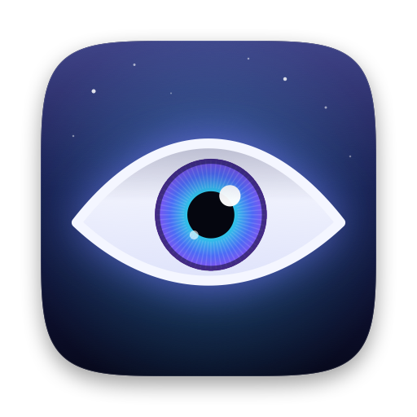
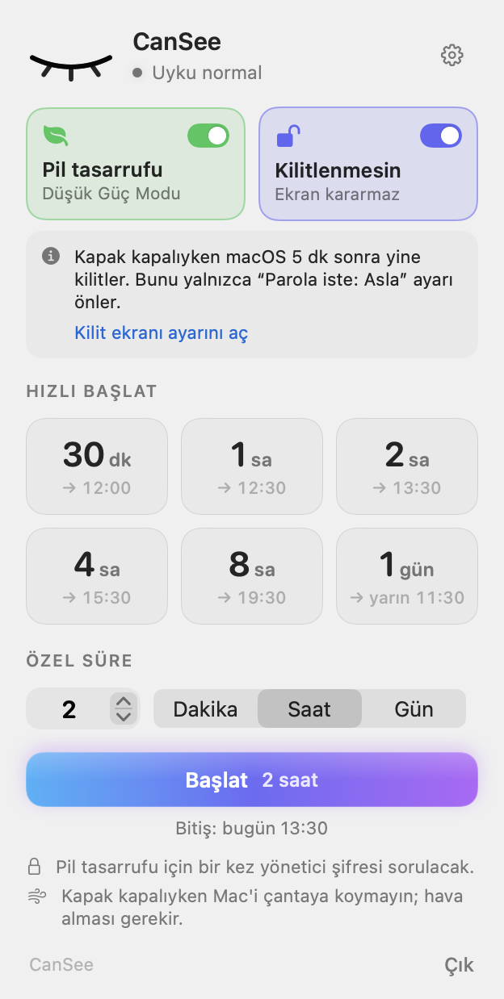
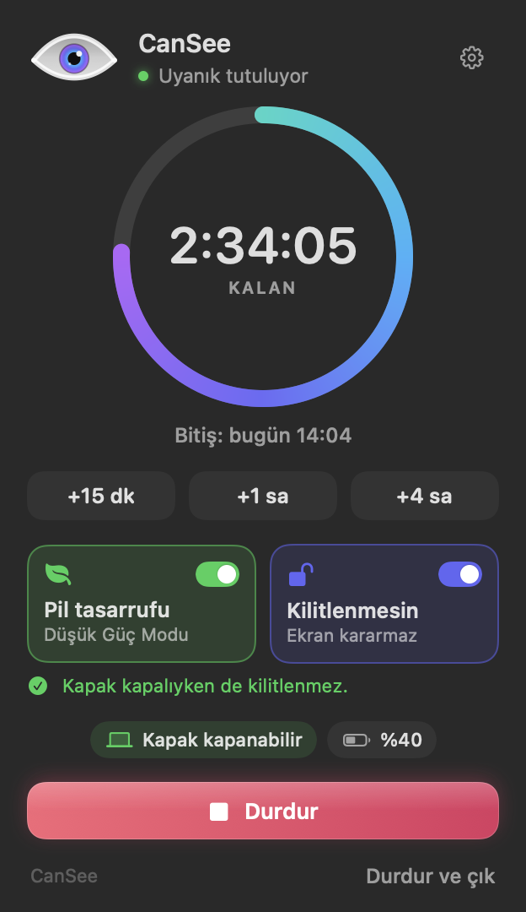
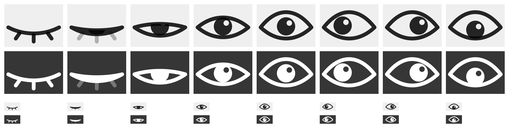

<p align="center">
  
</p>

<h1 align="center">CanSee</h1>

<p align="center">
  <b>Mac'iniz kapak kapalıyken bile uyanık kalsın, yapay zekâ ajanlarınız çalışmaya devam etsin.</b><br>
  Apple Silicon MacBook'lar için küçük bir menü çubuğu uygulaması.
</p>

<p align="center">
  <a href="https://github.com/BerkeMulat/CanSee/releases/latest">İndir</a> ·
  <a href="README.md">English</a>
</p>

<p align="center">
  
  &nbsp;
  
</p>

## Neden?

Uzun süren ajan işleri (Claude Code, Codex, ChatGPT ve benzerleri) kapağı kapattığınız anda durur, çünkü macOS Mac'i uyutur. `caffeinate` işe yaramaz: yalnızca *boşta kalma* uykusunu engeller, kapak kapanınca gelen uyku ise başka bir yoldan işler. CanSee, Mac'i tam olarak seçtiğiniz süre boyunca (dakika, saat ya da gün) uyanık tutar, sonra değiştirdiği her ayarı eski haline getirir.

## Özellikler

- **Kapak kapalı modu.** Mac, kapak kapalıyken de çalışmaya devam eder; harici ekran gerekmez.
- **İstediğiniz süre.** 30 dakikadan 1 güne tek tıkla hazır süreler ya da istediğiniz kadar dakika, saat veya gün. Süren bir oturumu +15 dk, +1 sa ya da +4 sa uzatabilirsiniz.
- **Uyku her durumda geri gelir.** Süre dolunca, Durdur'a basınca ya da çıkınca, oturum kapatılınca veya yeniden başlatılınca, `killall` ile kapatılınca, hatta uygulama çöker ya da zorla kapatılırsa bile. Bu son durumda küçük bir bekçi süreç uykuyu süre bitiminde geri açar. Elektrik kesilirse, CanSee bir sonraki girişte durumu düzeltir.
- **Pil tasarrufu.** Oturum boyunca macOS Düşük Güç Modu'nu açar (daha az ısı, daha uzun pil), bitince eski ayarınızı geri yükler.
- **Kilitlenmesin.** Ekranın boşta kararmasını engeller; kapak açıkken ekran koruyucu ve kilit hiç devreye girmez. Kapak kapalıyken ne olduğu için [Kilit ekranı hakkında](#kilit-ekranı-hakkında) bölümüne bakın.
- **Güvenlik korumaları.** Pil azalınca (şarjda değilken, varsayılan %10) ya da Mac kritik sıcaklığa ulaşınca oturumu bitirir ve bildirim bırakır.
- **İzleyen bir göz.** Menü çubuğundaki göz boştayken uyur, oturum başlayınca uyanır, ara sıra göz kırpar ya da etrafa bakar. Ekran kapalıyken tamamen durur.
- **Yalnızca menü çubuğu.** Dock'ta simge yok, ⌘-Tab'da görünmez. Hızlı işlemler için göze sağ tıklayın.
- **Hafif.** Boştayken yaklaşık 12 MB bellek ve %0 CPU kullanır. Her şey olaylarla çalışır; sürekli kontrol yapan bir döngü yoktur.

<p align="center">
  
</p>

## Kurulum

1. [Releases](https://github.com/BerkeMulat/CanSee/releases/latest) sayfasından **CanSee-2.1.dmg**'yi indirin ve CanSee'yi Uygulamalar klasörüne sürükleyin.
2. Derleme imzalı ama notarize edilmemiş, bu yüzden macOS ilk seferde açmaz. **Sistem Ayarları › Gizlilik ve Güvenlik**'e gidip **Yine de Aç**'a basın ya da şunu çalıştırın:
   ```sh
   xattr -dr com.apple.quarantine /Applications/CanSee.app
   ```
3. Menü çubuğunda bir göz belirir. CanSee, Uygulamalar'dan ilk açılışında kendini Giriş Öğeleri'ne ekler; bunu ayarlarından kapatabilirsiniz.
4. İlk kapak kapalı oturumda bir kez yönetici şifresi sorulur (bkz. [İzinler](#izinler)).

## Kullanım

Göze tıklayın, bir süre seçin ve kapağı kapatın. Mac uyanık tutulduğu sürece göz açık kalır, oturum bitince kapanır. Kapak kapalıyken çalışan Mac'i çantaya koymayın; hava alması gerekir.

## Kilit ekranı hakkında

Kapak kapanınca ekran donanım tarafından kapatılır. macOS da o anda "Ekran koruyucu başladıktan veya ekran kapandıktan sonra parola iste" sayacını başlatır. Apple'ın `IOPMLib.h` belgesine göre hiçbir uygulama, kapak kapalıyken ekranı açık tutamaz. Bu yüzden:

- **Kapak açıkken** (ya da harici ekranla kapak kapalıyken): *Kilitlenmesin* açıksa ekran hiç kararmaz, Mac hiç kilitlenmez.
- **Kapak kapalıyken**: ekran, **Sistem Ayarları › Kilitli Ekran**'daki süre dolunca kilitlenir. Bunu önlemek için "Parola iste…" ayarını **Asla** yapın. CanSee şu anki süreyi gösterir ve doğrudan bu ayara götürür. Bu durumda kapağı açan herkesin Mac'i kullanabileceğini unutmayın.

## İzinler

Kapak kapanınca gelen uykuyu engellemek ve Düşük Güç Modu'nu açıp kapamak root yetkisi ister. CanSee ilk kullanımda `/private/etc/sudoers.d/cansee-<uid>` konumuna tek bir dar kapsamlı sudoers kuralı kurar; kural kurulmadan önce `visudo` ile denetlenir. Kural yalnızca şu komutlara şifresiz izin verir:

```
/usr/bin/pmset -a disablesleep 0|1
/usr/bin/pmset -b lowpowermode 0|1
/usr/bin/pmset -c lowpowermode 0|1
```

Root olarak başka hiçbir şey çalışmaz. Kuralı istediğiniz zaman **Ayarlar › Yönetici izni › Kaldır** ile silebilirsiniz. Şifre penceresini iptal ederseniz CanSee, Mac'i yine de kapak açıkken uyanık tutar.

## Nasıl çalışır?

| Parça | Görevi |
| --- | --- |
| `Core/AwakeManager` | Oturum durumu; oturum başına tek bir saat zamanlayıcısı vardır, bitişe kadar hiçbir şey uyanmaz |
| `Core/SleepControl` | `pmset` çağrıları, sudoers kuralı ve IORegistry okumaları (`SleepDisabled`, kapak durumu) |
| `Core/SessionStore` | Oturumu diske kaydeder; ayrı çalışan bir `zsh` bekçisi (yalnızca yerleşik komutlar, dakikada en fazla bir uyanma) uygulama ölürse tüm değişiklikleri geri alır |
| `Core/PowerMonitor` | Pil, ısı ve Düşük Güç Modu değişikliklerini sistem bildirimlerinden alır; yalnızca gerektiğinde dinler |
| `Eye/` | Menü çubuğu ikonu, panel ve uygulama ikonunun ortak göz çizimi; kareler yalnızca animasyon sürerken çizilir |
| `UI/` | SwiftUI paneli; ilk açılışta oluşturulur, kapandıktan sonra bellekten bırakılır |

## Kaynaktan derleme

macOS 27 ve Xcode 27 gerekir.

1. `CanSee.xcodeproj`'yi açın.
2. **Signing & Capabilities** altında kendi takımınızı seçin.
3. Çalıştırın. **App Sandbox**'ı kapalı tutun: uygulamanın `sudo pmset` çağırabilmesi gerekir.

## Gereksinimler

Apple Silicon üzerinde macOS 27 veya üstü. Kapak kapalı modu için MacBook gerekir; masaüstü Mac'lerde CanSee yalnızca boşta kalma uykusunu engeller.

## Lisans

[MIT](LICENSE) © 2026 Berke Mulat
